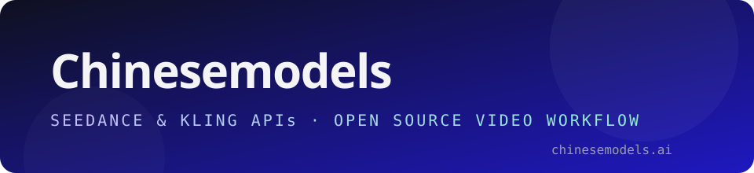

<p align="center">
  <a href="https://chinesemodels.ai"></a>
</p>
<p align="center"><a href="https://chinesemodels.ai"><strong>Get your API key →</strong></a></p>

<h1 align="center"> Chinesemodels — Open Source Workflow</h1>
<p align="center">Your scene. New characters.</p>
<p align="center">
  <a href="https://chinesemodels.ai"><strong>Get the Seedance / Kling API</strong></a> ·
  <a href="docs/SETUP-AGENT.md">Agent setup</a> ·
  <a href="#manual-setup">Manual setup</a> ·
  <a href="LICENSE">MIT license</a>
</p>

A local UI and agent-assisted workflow for replacing video subjects using colored depth, SAM 3 masks and Seedance through Chinesemodels. Draft at a preview resolution first; approve before the 1080p pass. The final export restores the **entire original source audio**, not generated audio.

## Get access

- **[Get your Seedance or Kling API key at Chinesemodels.ai](https://chinesemodels.ai)** — one prepaid balance and one API key across the catalogue. Keys start with `sk-cm-`. This workflow edits through `bytedance/seedance-2.5/reference-to-video` (Seedance) or `kwaivgi/kling-v4.0/video-edit` (Kling).

## Easiest setup: let your coding agent install it

Extract the ZIP, open **this folder** in Codex or another coding agent with terminal/file access, and paste:

> Set up this Chinesemodels — Open Source Workflow project for me. Read `docs/SETUP-AGENT.md` and follow it end to end. Detect my OS, install missing Python and Rubber Band prerequisites using the supported package manager, create the main virtual environment, install dependencies, install Python 3.12 and run `bash setup-face-mesh.sh` for both mesh modes, and create `.env` without overwriting it. Open `.env` so I can enter my own keys privately. Run the local tests, launch the app, run the strict readiness check on a free localhost port, verify the UI and companion images, and give me the working URL. Work independently through setup, respecting system permission prompts. Do not submit paid generations. If keys are missing, launch the UI and clearly tell me generation is waiting for them.

The agent uses the included [setup runbook](docs/SETUP-AGENT.md). You only need to supply your own provider keys and approve any required system installation. No separate agent install is required. Native Windows users should use WSL2; macOS/Linux launch scripts are included.

## Manual setup

1. Install Python 3.12+ and the Rubber Band CLI:
   - macOS: `brew install rubberband`
   - Ubuntu/Debian or WSL: `sudo apt install rubberband-cli python3-venv`
   No tunnel or callback receiver is needed — Chinesemodels is poll-based.
2. In this folder, run `bash setup.sh`. This creates an isolated `.venv`, installs `requirements.txt`, creates a blank `.env`, and checks dependencies. To enable all three modes, install Python 3.12 and run `bash setup-face-mesh.sh`, then `.venv/bin/python doctor.py --mesh`. On macOS, install the worker interpreter with `brew install python@3.12` if needed.
3. Fill `.env` with **your own** `CHINESEMODELS_API_KEY` (from [chinesemodels.ai](https://chinesemodels.ai)) and `REPLICATE_API_TOKEN` (from [Replicate](https://replicate.com/account/api-tokens)). Fund/enable the relevant accounts. `HF_TOKEN` is optional for the Hugging Face depth alternative.
4. Run `./start.command` (or `bash start.command`). Open **http://127.0.0.1:8770**. Use `PORT=8771 bash start.command` if the port is occupied.
   - Once running, check `.venv/bin/python doctor.py --require-keys`.
5. Upload your own MP4/MOV, prepare it, inspect the entire mask and prepared video, approve that exact mask, provide your own character references, review the prompt, and create a draft.
6. When you like the draft, approve it to regenerate at 1080p. The draft and final remain separate; both previews use source audio.

No local model weights or GPU are needed for the default setup. Python packages and the Rubber Band executable are required locally.

## What happens

1. Save the source unchanged; extract audio and separate vocals/music with Demucs on Replicate.
2. Pitch isolated vocals **+3 semitones**, maintaining duration with Rubber Band.
3. Normalize the working video to 24 fps, up to 960 pixels; obtain colored depth with `lucataco/depth-anything-video`. Preserve returned colors.
4. Use SAM 3 raw PNG masks on depth. Check alignment, coverage and background spill. An agent can retry segmentation on the original RGB if depth loses detail.
5. Composite the depth subject over the original background. Mandatory full-clip visual mask review gates every generation. Approval is bound to hashes of the current artifacts.
6. Embed the pitched vocals into the composite MP4, upload it plus your character references to Chinesemodels, and edit that composite. No standalone audio is sent.
7. Chinesemodels quotes the request, then generates. The draft runs at `CHINESEMODELS_PREVIEW_RESOLUTION` (default 480p).
8. Poll to completion, download the result, discard its audio and copy the complete original soundtrack into the final MP4.
9. On approval, regenerate at `CHINESEMODELS_RESOLUTION` (default 1080p) and restore the soundtrack again.

## Autonomous agent operation

Open this folder in your coding agent and ask it to follow `AGENTS.md` and `.agents/skills/chinesemodels-video-workflow/SKILL.md`. No particular agent vendor or model is required, but it must be able to inspect video and files, run Python, and access the network.

Example: “Use the Chinesemodels workflow for my clip and references. Prepare and inspect the entire mask, repair it if needed, show the prompt, submit the authorized draft, and retrieve the final preview. Wait for my approval before the final pass.”

See [agent operations](docs/AGENT-OPERATIONS.md), [API integration](docs/CHINESEMODELS-API.md), [models](docs/MODELS.md), [media upload](docs/MEDIA-HOSTING.md), and [troubleshooting](docs/TROUBLESHOOTING.md).

## Recovery and checks

```bash
.venv/bin/python doctor.py --require-keys
.venv/bin/python test_composite.py
.venv/bin/python -m unittest discover -s tests
.venv/bin/python workflow.py status LOCAL_JOB_ID
.venv/bin/python workflow.py resume LOCAL_JOB_ID
.venv/bin/python workflow.py resume LOCAL_JOB_ID --hd
```

The server resumes saved retrieval on restart. It never re-submits a paid request. Preparation interrupted during a remote model call requires agent inspection of saved prediction metadata; do not blindly restart billed stages. Keep one server/collector per job. This is a local single-user application, not a multi-user hosted service. Bind to localhost; add authentication and a durable worker queue before public hosting.

## Provider state (2026-10-26)

- **Seedance 2.5 reference-to-video** — quoting works; a 720p edit quoted $10.80, 1080p quoted $21.25.
- **Kling 4.0 video-edit** — every quote returned `Generation is temporarily unavailable`. Kling editing will not render through this route until Chinesemodels restores it; see [troubleshooting](docs/TROUBLESHOOTING.md).

## Before publishing on GitHub

Use this clean project folder, not a working installation containing jobs or credentials. `.gitignore` excludes secrets, environments, generated jobs and logs; it cannot remove files already committed to Git history. Keep `.env.example` blank for secrets. Do not commit `.env`, provider responses or run folders.

## License

Code and documentation: [MIT](LICENSE), copyright © 2026 Chinesemodels. Based on the open-source Genjustsu workflow (MIT, © 2026 Sirio Berati); the original MIT notice is retained. The Chinesemodels name and logos are trademarks of their owner; the MIT grant covers code and documentation only. Third-party dependencies and services retain their own licenses and terms. See [third-party notices](THIRD-PARTY.md).

## Tech stack

| Layer | Technology and purpose |
| --- | --- |
| Local app | Python 3.12+, FastAPI, Uvicorn; HTML, CSS and vanilla JavaScript UI |
| Video/audio processing | PyAV, NumPy, Pillow, OpenCV and SciPy; local encoding, compositing and audio restoration |
| Vocal isolation | Hosted Demucs / htdemucs through Replicate |
| Pitch | Rubber Band CLI; isolated vocals +3 semitones without changing duration |
| Colored depth | Replicate `lucataco/depth-anything-video`; optional Hugging Face Video Depth Anything or `chenxwh/depth-any-video` |
| Segmentation | Replicate `lucataco/sam3-video`; raw per-frame masks and mandatory visual review |
| Face mesh | Local Google MediaPipe Face Landmarker; saved landmarks and overlay, isolated Python 3.12 worker environment |
| Generation | Chinesemodels Seedance 2.5 or Kling 4 editing; quote, submit, poll; draft at preview resolution, approved final at 1080p |
| Media upload | Chinesemodels `/api/reference-media`; no third-party host or storage account |
| Completion | Persisted job files and polling (no webhook or tunnel required) |
| Agent workflow | Included AGENTS.md, setup runbook, skill and CLI; a user-supplied coding agent performs visual QA |

Fast face mesh skips both depth and SAM. Combined mode uses depth + SAM + facial landmarks. All modes embed pitched vocals before generation and restore the original source soundtrack afterward.

---

## The working recipe and fully-local build

**Read [`docs/WORKING-RECIPE.md`](docs/WORKING-RECIPE.md)** — the exact prompts
that preserve motion and voice, the three steps (pitch/embed → generate → restore
original audio), and the provider quirks that decide success.

Key points:
- Use a **direct replacement prompt** ("Replace X with Y, keep everything else"),
  not a scene-script. Scene-scripts regenerate the whole clip and lose your motion
  and your audio.
- The three Replicate calls (depth, SAM, Demucs) now **fall back to local models**
  when `REPLICATE_API_TOKEN` is absent, via `local_models.py`. No Replicate key needed.
- `bin/rubberband.bat` shims the `rubberband` CLI with ffmpeg's `rubberband` filter
  on Windows, so `doctor.py` passes without a rubberband install.
- For **Atlas Cloud** generation, omit `omni_reference_task_type` and use a source
  **≥ 4 s** (both are required or the edit is rejected with a misleading
  ratio/duration error).
